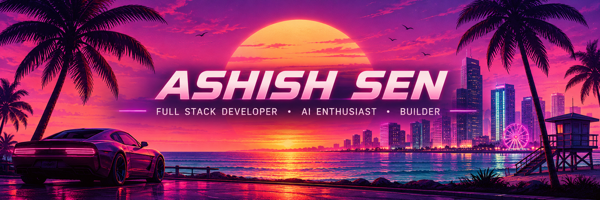

<!-- VICE CITY // ASHISH SEN -->

  

<h3 align="center">FULL-STACK DEVELOPER · AI ENTHUSIAST · BUILDER</h3>

  <i>Building useful things. Exploring bold ideas. Shipping one commit at a time.</i>

  
  
  

---

## 🌴 THE STORY

Hey, I'm **Ashish Sen** — a developer who enjoys turning ideas into working products. I work across frontend and backend development, and I'm especially interested in AI-powered applications and the Model Context Protocol (MCP).

- 🔭 Building full-stack applications and AI-first tools.
- 🧠 Exploring LLM integrations, LangGraph and MCP.
- ⚙️ Interested in backend systems, APIs and collaborative real-time experiences.
- 🚀 Focused on becoming a stronger software engineer through building.

## 🌆 THE PROJECT GARAGE

<table>
  <tr>
    <td width="50%" valign="top">
      <h3>💸 <a href="https://github.com/Ashish96300/Oqita---AI-First-Personal-Finance-Manager">Oqita</a></h3>
      
An AI-first personal finance manager with a web dashboard and remote MCP server, so users can manage and understand their finances through a traditional interface or compatible AI assistants.

      
Python · FastAPI · FastMCP · PostgreSQL · Next.js · WorkOS

      <a href="https://oqita.vercel.app">Live application ↗</a>
    </td>
    <td width="50%" valign="top">
      <h3>🎨 <a href="https://github.com/Ashish96300/konvas">Konvas / DrawPad</a></h3>
      
Turn your phone into a wireless trackpad or stylus for your laptop, paired over your local network.

      
Electron · Node.js · Socket.IO · Expo · React Native · Skia

      <a href="https://github.com/Ashish96300/konvas">Explore the repository ↗</a>
    </td>
  </tr>
  <tr>
    <td width="50%" valign="top">
      <h3>⚔️ <a href="https://github.com/Ashish96300/DevBrawl">DevBrawl</a></h3>
      
A real-time collaborative coding interview platform with multiplayer rooms, shared coding, whiteboarding and AI-assisted feedback.

      
React · Node.js · Socket.IO · MongoDB · Monaco · tldraw

      <a href="https://github.com/Ashish96300/DevBrawl">Explore the repository ↗</a>
    </td>
    <td width="50%" valign="top">
      <h3>🎬 <a href="https://github.com/Ashish96300/AiVideoAssistant">AI Video Assistant</a></h3>
      
A Streamlit demo for transcript-first processing and AI-assisted exploration of YouTube videos.

      
Python · Streamlit · AI integrations

      <a href="https://oqita-aivideoassistant.streamlit.app/">Open the demo ↗</a>
    </td>
  </tr>
</table>

## 🛠️ THE TOOLKIT

  

## 📡 SIGNALS FROM THE CITY

  
  

  

---

  <b>KEEP BUILDING. KEEP EXPLORING.</b> 
  VICE CITY // EST. 2026

